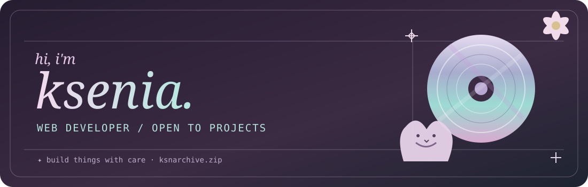
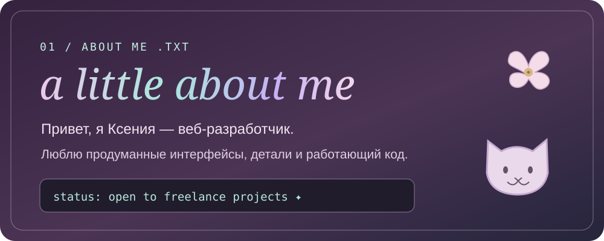
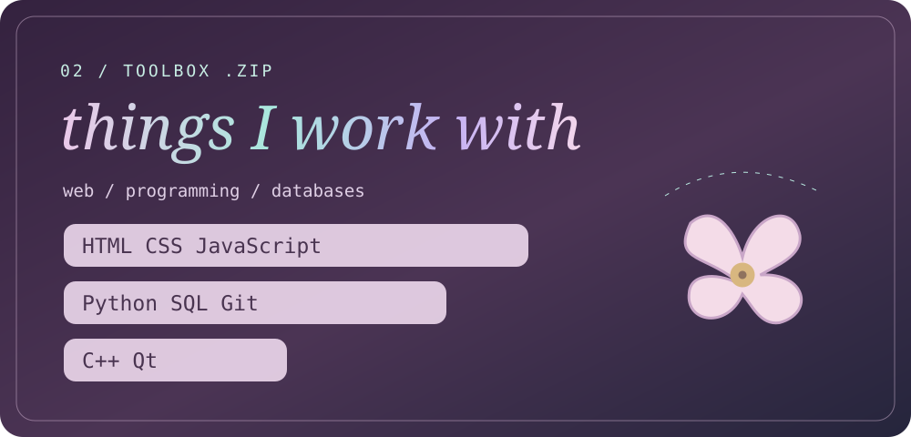
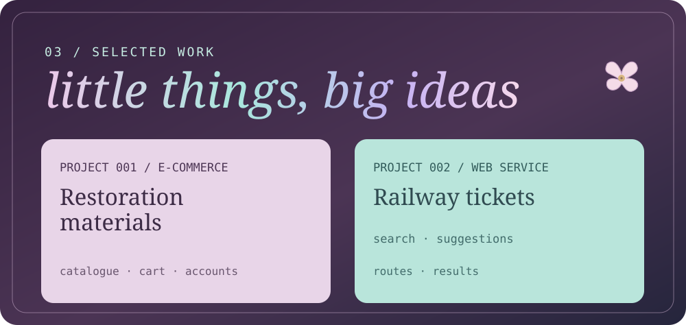
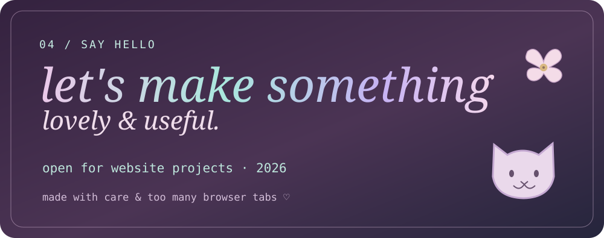

 

 

 

✧ подробнее о проектах / project notes

**Restoration Materials** — проект сайта с каталогом реставрационных материалов, корзиной и личным кабинетом. Ссылка на исходники появится после публикации.

**Railway Tickets** — интерфейс поиска железнодорожных билетов с подсказками и результатами поиска. Ссылка на исходники появится после публикации.

<a href="https://github.com/ksnarchive?tab=repositories">✦ view repositories</a> · <a href="https://github.com/ksnarchive/ksnarchive">✿ profile source</a>

Ссылки на демо и контакт для заказов добавим после публикации.

