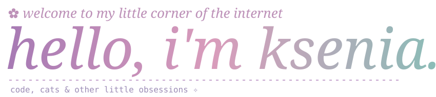
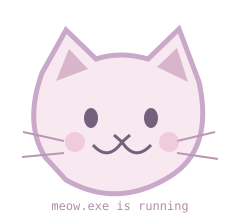

✿ web development · pretty interfaces · little internet things ✿

  

<a href="https://github.com/ksnarchive?tab=repositories">repositories</a> &nbsp;·&nbsp; <a href="#-my-toolbox">tech stack</a> &nbsp;·&nbsp; <a href="#-little-projects">projects</a>

---

<table>
<tr>
<td width="67%" valign="top">

### ♡ hi there!

i'm **ksenia**, a developer who loves making things that are both useful and pretty.

Пишу код, создаю сайты и люблю продуманные интерфейсы. Здесь храню проекты, эксперименты и всё, что мне интересно.

- 🌷 **focus:** web development & UI
- ☁️ **learning:** always something new
- 💌 **status:** open to freelance projects

somewhere between clean code and cute design ♡

</td>
<td width="33%" align="center" valign="middle">

</td>
</tr>
</table>

### ✧ my toolbox

HTML · CSS · JavaScript · Python · SQL · C++ · Qt · Git

### ✿ little projects

| project | about |
| :--- | :--- |
| **01 · restoration materials** | Сайт-каталог реставрационных материалов: товары, корзина, избранное и личный кабинет. |
| **02 · railway booking** | Интерфейс поиска железнодорожных билетов с подсказками и результатами поиска. |

✧ Ссылки на исходники и демо появятся после публикации проектов.

---

 &nbsp; 

**thanks for stopping by ♡**

made with curiosity, care & too many browser tabs

