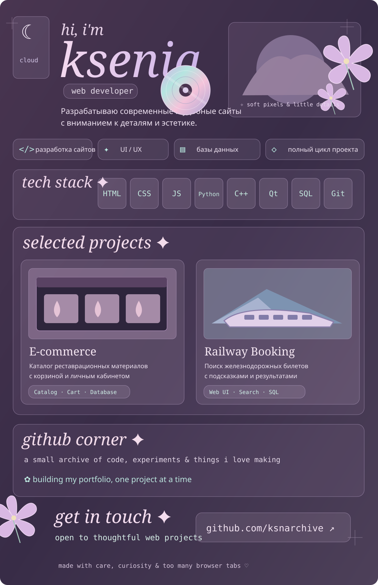

 

<a href="https://github.com/ksnarchive?tab=repositories">✧ repositories</a> &nbsp;·&nbsp; <a href="https://github.com/ksnarchive/ksnarchive">♡ source</a>

✿ Подробнее обо мне и проектах

Привет! Я Ксения, занимаюсь веб-разработкой и интерфейсами. Работаю с HTML, CSS, JavaScript, Python, SQL, C++, Qt и Git.

**Restoration Materials:** сайт-каталог реставрационных материалов с корзиной и личным кабинетом. **Railway Booking:** интерфейс поиска железнодорожных билетов. Ссылки на исходники и демо добавлю после публикации.

Открыта к интересным веб-проектам. Контакт для связи будет добавлен отдельно.

